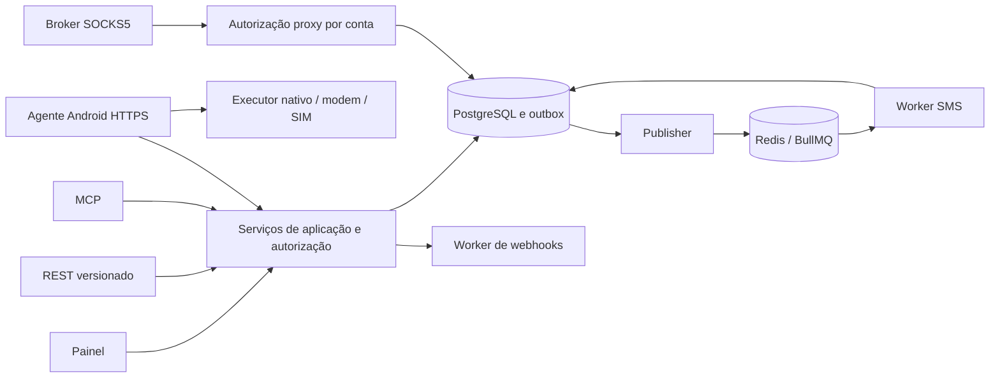

# Arquitetura e mapa de integração

## Estado observado em 13/10/2026

| Componente existente | Caminho | Impacto projetado |
|---|---|---|
| Web/API Next.js 16.2.10 | `web/src/app`, `web/AGENTS.md` | Rotas versionadas, equipe, SMS e billing; ler docs locais do Next antes de editar |
| Prisma 7/PostgreSQL | `web/prisma/schema.prisma`, migrations | Conta, escopos, assinaturas, mensagens/outbox e migração aditiva |
| Auth jose/bcrypt | `web/src/lib/auth.ts`, `web/src/proxy.ts` | Identidade continua User; autorização resolve membership, não apenas role global |
| Cobrança | `web/src/lib/payment-events.ts`, `billing-period.ts`, API billing | Entitlements independentes e eventos idempotentes por cobrança |
| Worker simples | `web/src/lib/worker.ts` | Não há worker SMS pronto; criar processos/fila dedicados |
| Proxy access | `web/src/lib/proxy-access.ts`, API internal | Migrar dono para conta mantendo shares e créditos legados |
| Broker Go | `broker/internal/tunnel/websocket.go`, `socks5.go` | Identidade de conta e regressão; payload TCP binário permanece compatível |
| HiveNode Expo 54/RN 0.81 | `hivenode-app/src/app/index.tsx`, `app.json` | Módulo Kotlin/Java nativo e UI de autorização SMS |
| Light Java + Go | `hivenode-light/android-app`, `native-go` | Modernizar build e agente Java; SMS somente API >=26 |
| Testes atuais | `docker-compose.test.yml`, `web/scripts/test-env.ts` | Baseline isolado; simulador SMS é trabalho novo |

`hivenode-app` é gitlink/repositório próprio. Publicações futuras precisam acompanhar seus commits, além do repositório raiz. Nenhum arquivo dessa área é implementado por este pacote documental.

## Decisão: plano de controle SMS independente do túnel proxy

Usar HTTPS autenticado para inventário, preview, claim, grant e eventos SMS. O agente pode operar SMS sem um túnel SOCKS5 conectado e sem assinatura proxy. Evita acoplar a autorização SMS aos códigos DIAL e ao transporte TCP binário atual.

Broker continua atendendo proxy e eventos de conectividade autorizados. É adaptado para contas/equipes, mas não passa a ter decisão de envio SMS. Uma futura otimização de notificação por WebSocket não altera as transações HTTP ou a autorização física.



## Fronteiras

- Serviços de aplicação validam todos os canais; não duplicar regras em páginas, handlers ou MCP.
- PostgreSQL guarda intenção, autorização, estado, política e eventos. Redis transporta trabalho/cache; indisponibilidade não elimina a intenção.
- Worker seleciona mensagem/linha elegível, verifica identidade, estado e validade. Não executa modem.
- Agente identifica instalação/linha, persiste inbox local, calcula segmentos e solicita grant antes do efeito físico.
- Executor nativo persiste início, chama SmsManager uma vez por tentativa, registra callbacks por segmento e envia eventos mesmo sem JS ativo.
- Webhook/exportação recebem apenas dados necessários e escopos permitidos; nenhuma credencial proxy entra em payload SMS.

## Organização proposta (A CRIAR)

```text
web/src/lib/workspaces/       context, permissions, membership, migration
web/src/lib/entitlements/     calculation, snapshots, capacity locks
web/src/lib/sms/              service, state-machine, policies, diagnostics
web/src/lib/sms/device/       claims, grants, events, reconciliation
web/src/lib/sms/webhooks/     signing, delivery, SSRF policy
web/src/lib/sms/jobs/         outbox, scheduling, retention
web/src/app/api/v1/           contas, equipe, SMS, credenciais
web/src/app/api/device/v1/    agente autenticado por instalação
web/src/app/dashboard/sms/   painel SMS
web/src/app/dashboard/team/  equipe
web/src/workers/              sms-worker, outbox-worker, webhook-worker
web/scripts/sms-simulator.ts  simulador sem modem
hivenode-app/modules/hivenode-sms/  módulo nativo local Expo
hivenode-light/android-app/.../sms/ agente e executor Java
mcp/                         bridge stdio e, depois, transporte HTTP OAuth
```

Os caminhos são alvos sugeridos, não arquivos existentes. Manter contratos compartilhados em local importável sem trazer dependências do servidor para o app. Fixar versões de pacotes novos e adicionar lockfile; não atualizar Next/Expo em bloco para desenvolver SMS.

## Estratégia de segundo plano

O agente sincroniza quando está disponível e usa execução nativa persistente. Foreground service precisa tipo legítimo e avaliação para o target efetivo. `dataSync` não garante 24/7: Android moderno impõe limites de duração. WorkManager serve para reconciliação eventual, não para prometer latência instantânea. [Limites do Android](https://developer.android.com/develop/background-work/services/fgs/timeout).

Gate de investigação compara operação visível iniciada pelo cliente, reconciliação WorkManager e wake-up FCM opcional sem conteúdo. Nenhum hack de Accessibility, root, broadcast abusivo ou troca artificial de tipo FGS é aceitável. Não mudar o ciclo de vida do proxy existente sem teste de regressão. Se o aparelho ficar indisponível, UX informa fila/pausa.

## Feature flags projetadas

`TEAM_WORKSPACES_ENABLED`, `SMS_ENABLED`, `SMS_REAL_SEND_ENABLED`, `SMS_TRIAL_ENABLED`, `SMS_MCP_REMOTE_ENABLED`, `SMS_LIGHT_ENABLED`. Flags do servidor não são licença de acesso. Cliente não pode sobrescrevê-las. Real send false permite sandbox/simulador, jamais modem. Desabilitar novas concessões mantém ingestão de eventos finais e leitura permitida.
